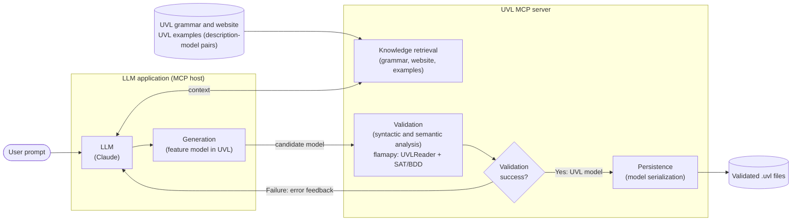

# MCP4UVL: Toward Reliable AI-Assisted Feature Modeling

MCP server and experimental data accompanying the article **"Toward Reliable AI-Assisted Feature Modeling"** by Máximo Prados, José Miguel Horcas, and Mónica Pinto (University of Málaga, ITIS Software), submitted at the *Computer* theme article series *The Future of Software Engineering in an AI-Native World* (IEEE Computer Society).

The repository turns an off-the-shelf LLM assistant (we use Claude Sonnet 4.6) into a **self-correcting assistant for the [Universal Variability Language (UVL)](https://uvl-ecosystem.org)**. Instead of expecting the model to master a low-resource modeling language, we ground it in the tools engineers already trust: the official grammar, worked examples, and automated analyses. The assistant drafts a feature model, validates it, reads the diagnostics, and repairs its own output until every check passes.

> **Key results** (11 expert-authored reference models, Claude Sonnet 4.6)
> * Syntactic validity: **27% → 100%** when the LLM is connected to the MCP server.
> * Refinement iterations: **7.6 → 1** when few-shot examples are added.
> * Generation time: **126 s → 30 s** with examples (19 s for the unaided LLM).
> * Levenshtein distance to the reference models: **303 → 277 → 163** (Sets A, B, C).
>
> Tool grounding guarantees that a generated artifact is *formally* correct, not that it captures the modeler's *intent* (see [Limitations](#limitations)).

---

## Table of contents

- [MCP4UVL: Toward Reliable AI-Assisted Feature Modeling](#mcp4uvl-toward-reliable-ai-assisted-feature-modeling)
  - [Table of contents](#table-of-contents)
  - [Motivation](#motivation)
  - [Architecture](#architecture)
    - [Key design decisions](#key-design-decisions)
  - [MCP tools](#mcp-tools)
    - [Validation workflow](#validation-workflow)
  - [Repository structure](#repository-structure)
  - [Installation](#installation)
  - [Connecting to Claude Desktop](#connecting-to-claude-desktop)
  - [Usage](#usage)
  - [Evaluation and reproducibility](#evaluation-and-reproducibility)
    - [Metrics](#metrics)
    - [Results](#results)
    - [Generated models](#generated-models)
  - [Limitations](#limitations)
  - [Useful links](#useful-links)

---

## Motivation

In an AI-native development process, engineers will ask language models to produce not only code but also the formal artifacts software engineering depends on: models, specifications, configurations, and domain-specific languages (DSLs). Modeling notations such as UVL have small user communities and few public examples, so LLMs have seen little of them during training and their output is correspondingly unreliable. Typical failures are:

* **Factual hallucinations**: invented keywords (e.g., an `excludes` keyword that does not exist in UVL) or features with no counterpart in the domain.
* **Faithfulness hallucinations**: output that diverges from the request or is internally inconsistent (e.g., a feature that is both mandatory and excluded).

Prompt engineering cannot supply knowledge the model lacks, and it offers no way to verify the result. Human engineers solve the same problem with external support: they consult the language reference, study examples, run the compiler, and fix what it reports. This project gives an LLM that same support through the [Model Context Protocol (MCP)](https://modelcontextprotocol.io).

## Architecture

The LLM orchestrates the agentic loop; the MCP server provides authoritative language knowledge, deterministic validation, and persistence.



The separation of responsibilities is central to the design:

* The **LLM** interprets the requirements and decides how to revise the model.
* The **server** provides controlled access to external knowledge and deterministic validation operations. Correctness is *not* left to the LLM's self-assessment.

### Key design decisions

1. **Authoritative language knowledge.** Rather than relying on the LLM's parametric knowledge, the server retrieves the official UVL grammar (syntactic rules) and the UVL website/README (explanations and usage conventions).
2. **Examples as complementary guidance.** A grammar defines the valid constructs but does not explain how to translate requirements into a feature model. The server therefore also serves few-shot examples pairing natural-language descriptions with their UVL models.
3. **Reuse of the flamapy ecosystem.** Validation builds on [flamapy](https://docs.flamapy.org), the community-maintained Python framework for the automated analysis of feature models, so the assistant relies on the same analyses engineers already trust.
4. **Controlled validation and persistence.** Candidate generation is separated from model acceptance. Dedicated storage directories, request timeouts, and disabled backend logging during validation (to keep the MCP channel clean) help protect the user's workspace and the communication channel.

## MCP tools

The server (`script/server.py`) exposes four tools in three categories, matching Table 1 of the article:

| Category | MCP tool | Purpose | flamapy operation |
|---|---|---|---|
| Knowledge retrieval | `get_uvl_grammar_rules` | Fetches the official UVL grammar (ANTLR4 `UVLParser.g4`) and the README of the UVL parser repository. | – |
| Knowledge retrieval | `get_uvl_examples` | Returns the few-shot examples (description + UVL model) stored in `script/few_shot_examples/`. | – |
| Validation | `validate_uvl_syntax_sat_bdd` | Checks the syntactic and semantic properties of a candidate model (see workflow below). | `UVLReader`, `PySATSatisfiable`, `BDDConfigurationsNumber`, `PySATDeadFeatures`, `PySATCoreFeatures`, `PySATFalseOptionalFeatures` |
| Serialization | `save_valid_model` | Persists a validated model as a `.uvl` file in `script/generated_models/`. | – |

### Validation workflow

`validate_uvl_syntax_sat_bdd` runs a staged pipeline:

1. **Clean-up.** Removes incidental formatting artifacts such as Markdown code fences.
2. **Parsing.** Parses the candidate with flamapy's `UVLReader`. Syntax errors are returned verbatim to the LLM.
3. **Satisfiability.** Checks with a SAT solver that the model admits at least one valid configuration. A void model is reported as a failure.
4. **Analysis.** For satisfiable models, the server computes the number of valid configurations (BDD) and identifies dead features, core features, and false-optional features.
5. **Feedback.** The diagnostics are returned to the LLM, which decides whether further refinement is needed. There are three possible outcomes:
   * `Validation failed` (syntax error or void model): the model must be repaired.
   * `Validation Warning` (satisfiable but with dead or false-optional features): the model must be repaired. A copy of the intermediate model is stored in `script/deficient_models/` for research purposes.
   * `Validation Success`: the model passed all checks and can be saved.

> Beyond the operations listed in Table 1 of the article (parsing, satisfiability, number of configurations, dead features), the implementation also reports core and false-optional features, and treats dead/false-optional features as anomalies that trigger another refinement round.

Before writing to disk, the server also replaces characters that LLMs often emit but the UVL parser does not accept (accented letters, long dashes, arrows).

## Repository structure

```
MCP4UVL/
├── README.md
├── .gitignore
├── script/
│   ├── server.py                    # MCP server (tools described above)
│   ├── requirements.txt             # Python dependencies (flamapy 2.5.0, mcp 1.27.1, ...)
│   ├── few_shot_examples/           # Description/model pairs served by get_uvl_examples
│   │   ├── Benavides2025_eShop_Boolean.{txt,uvl}
│   │   ├── Benavides2025_eShop_Arithmetic.{txt,uvl}
│   │   └── Benavides2025_eShop_Type.{txt,uvl}
│   ├── generated_models/            # Output of save_valid_model (git-ignored)
│   └── deficient_models/            # Intermediate models with anomalies (git-ignored)
└── generated_sets/                  # Experimental data of the article
    ├── set_A/                       # LLM only                 (11 models, prefix RAW_LLM_)
    ├── set_B/                       # LLM + MCP                (11 models, prefix MCP_)
    └── set_C/                       # LLM + MCP + examples     ( 8 models, prefix MCP_FileExamples_)
```

Each few-shot example is a pair of files with the same base name: a natural-language description (`.txt`) and its expert-authored UVL model (`.uvl`).

## Installation

Python 3.12 is recommended to ensure compatibility with the flamapy dependencies.

1. Clone or extract the repository and move into the `script` directory:

   ```bash
   cd MCP4UVL/script
   ```

2. Create an isolated virtual environment:

   ```bash
   python -m venv venv
   ```

3. Activate it:

   * **Windows:** `venv\Scripts\activate`
   * **macOS / Linux:** `source venv/bin/activate`

4. Install the dependencies:

   ```bash
   pip install -r requirements.txt
   ```

5. (Optional) Start the server manually to check that it works:

   ```bash
   python server.py
   ```

   If everything is correct, the terminal stays listening and prints `Starting UVL MCP server...`. Stop it with `CTRL + C`. Normally you do not need to run the server by hand: the MCP host (e.g., Claude Desktop) launches it automatically.

## Connecting to Claude Desktop

For the model to call the validation tools, the local server must be registered in an MCP host. The article uses Claude Desktop.

1. Install and open Claude Desktop.
2. Go to **File > Settings** and open the **Developer** tab.
3. Click **Edit Config** to open `claude_desktop_config.json`.
4. Add the server, pointing to the Python executable of the virtual environment and to `server.py`. Replace `/path/to/MCP4UVL` with the actual location of the project:

   **Windows**

   ```json
   {
     "mcpServers": {
       "uvl_mcp_server": {
         "command": "C:\\path\\to\\MCP4UVL\\script\\venv\\Scripts\\python.exe",
         "args": [
           "C:\\path\\to\\MCP4UVL\\script\\server.py"
         ]
       }
     }
   }
   ```

   **macOS / Linux**

   ```json
   {
     "mcpServers": {
       "uvl_mcp_server": {
         "command": "/path/to/MCP4UVL/script/venv/bin/python",
         "args": [
           "/path/to/MCP4UVL/script/server.py"
         ]
       }
     }
   }
   ```

5. Save the file and fully restart Claude Desktop (make sure it is also closed in the background).
6. Open a new chat, click the **Connectors** icon (the plug symbol or `+`), and verify that `uvl_mcp_server` is available.

## Usage

Once connected, describe the feature model you need in natural language and ask the assistant to use the available tools, for example:

> Using the UVL tools, model the following product line. A fictitious eShop has a mandatory Catalogue and Security (exactly one of Standard or High), and optional SEO, Payment (Bank Transfer or Credit Card, but not both) and Platform support... Validate the model and save it when it passes all checks.

The assistant is expected to:

1. call `get_uvl_grammar_rules` (and `get_uvl_examples`, when examples are available),
2. draft a UVL model,
3. call `validate_uvl_syntax_sat_bdd` and repair the model until it returns `Validation Success`,
4. call `save_valid_model`, which stores the file in `script/generated_models/`.

## Evaluation and reproducibility

We compared three configurations of Claude Sonnet 4.6 (accessed through its hosted API) on 11 expert-authored reference UVL models of increasing expressiveness (Boolean, Arithmetic, and Type level) taken from a previously published dataset (Horcas et al., VARIABILITY 2026). All configurations received the same natural-language requirements.

| Set | Configuration | Models | Folder |
|---|---|---|---|
| **A** | LLM only: parametric knowledge, no external resources, validation tools, or MCP. | 11 | `generated_sets/set_A/` |
| **B** | MCP-assisted: grammar retrieval, validation, and persistence. No modeling examples. | 11 | `generated_sets/set_B/` |
| **C** | MCP with examples: everything in B plus three description-model examples (Boolean, Arithmetic, Type). The LLM was instructed to use the tools throughout. | 8 | `generated_sets/set_C/` |

Set C excludes the three eShop models used as few-shot examples (`script/few_shot_examples/`), to avoid evaluating the assistant on examples it has already seen.

### Metrics

* **Syntactic validity**: whether flamapy can parse the generated output as a UVL model.
* **Refinement iterations**: number of correction cycles before an accepted model is obtained.
* **Generation time**: elapsed time per generation, including tool interaction. The per-model time is recorded in a trailing `// time -> ...` comment at the end of each generated file.
* **Levenshtein distance**: character-level distance to the reference model (a measure of textual similarity, not of semantic equivalence).

### Results

| Metric | Set A (LLM only) | Set B (MCP) | Set C (MCP + examples) |
|---|---|---|---|
| Syntactically valid models | 3 / 11 (**27%**) | 11 / 11 (**100%**) | 8 / 8 (**100%**) |
| Avg. refinement iterations | – | 7.6 | **1** |
| Avg. generation time | 19 s | 126 s | 30 s |
| Avg. Levenshtein distance | 303 | 277 | **163** |

Grounding the LLM in external validation rather than in its own self-assessment is what yields valid models; few-shot examples then make the candidates closer to the expected UVL structure, which sharply reduces the number of repair rounds and, consequently, the generation time.

Experimental setup: the MCP server and flamapy ran on a laptop with a 12th Gen Intel Core i5-12500H (2.50 GHz) and 16 GB of RAM running Windows 11.

> The evaluation is exploratory: it involves a relatively small number of reference models and a single LLM family; Set C uses fewer models; and generation times depend on the hosted LLM infrastructure and network latency.

### Generated models

Files follow the pattern `<prefix>_<Author><Year>_<Model>_<Level>.uvl`, where the level is the UVL expressiveness (`Boolean`, `Arithmetic`, or `Type`). The reference models used in the evaluation are:

| Reference model | Level(s) |
|---|---|
| `Knuppel2017_Pizza` | Boolean |
| `Sundermann2024_Pizza` | Type |
| `SerranoGutierrez2023_Multifunctional` | Type |
| `Benavides2025_eShop` (`Boolean`, `Boolean2`, `Arithmetic`, `Arithmetic2`, `Type`) | Boolean, Arithmetic, Type |
| `Horcas2021_AAFM` | Boolean |
| `Horcas2023_AAFM` | Attributes |
| `Munoz2022_Edge` | Boolean |

Some generated files carry inline `//` comments recording how the output differs from the hand-written reference (e.g., a relation modeled as `mandatory` instead of `or`).

The reference models themselves belong to the dataset of Horcas et al. and are not duplicated here.

## Limitations

Passing the syntactic and semantic checks does **not** mean that the model captures the intended requirements. The article illustrates this with the *Edge* system (Muñoz et al., SPLC 2022). The expert-authored model has 16 features, three hierarchy levels (Interface, Antenna, VNFs), an inclusive `or` group at the root, and **319** valid configurations. The unaided LLM (Set A) introduced an extra `Band` feature and replaced the inclusive grouping with `mandatory` relationships, yielding only **252** configurations. The MCP-assisted configurations (Sets B and C) removed the unnecessary `Band` feature but kept the incorrect mandatory relationships, so the model was syntactically valid and satisfiable, yet still unfaithful to the requirements. The validator cannot detect this, because it depends on the meaning of the natural-language description and not on formal consistency.

External validation can therefore prevent many structural and formal errors, but it cannot replace the interpretation of domain requirements. A more reliable assistant should also identify ambiguous or underspecified requirements and ask the user for clarification instead of silently committing to one interpretation.

Further considerations:

* Tool-calling gives the LLM real power over its environment. When an LLM executes tools autonomously, input sanitization, least privilege, and sandboxing are essential (see Hou et al., ACM TOSEM 2026, for the MCP threat landscape). The server therefore writes only to dedicated directories and uses a temporary file for validation.
* Improving semantic interpretation, particularly for arithmetic and typed constraints, is the main open direction, followed by integrating RAG with MCP, evaluating additional LLM families, and connecting the assistant to visualization and model translation tools.

<!-- ## Citation

If you use this work, please cite the article:

```bibtex
@article{prados2027reliable,
  author  = {Prados, M{\'a}ximo and Horcas, Jos{\'e} Miguel and Pinto, M{\'o}nica},
  title   = {Toward Reliable AI-Assisted Feature Modeling},
  journal = {Computer},
  publisher = {IEEE Computer Society},
  year    = {2027},
  note    = {Theme article: The Future of Software Engineering in an AI-Native World}
}
``` -->

## Useful links

* UVL ecosystem: <https://uvl-ecosystem.org>
* UVLHub repository: <https://www.uvlhub.io>
* flamapy documentation: <https://docs.flamapy.org>
* flamapy MCP server: <https://github.com/flamapy/flamapy-mcp>
* MCP specification: <https://modelcontextprotocol.io/specification>
